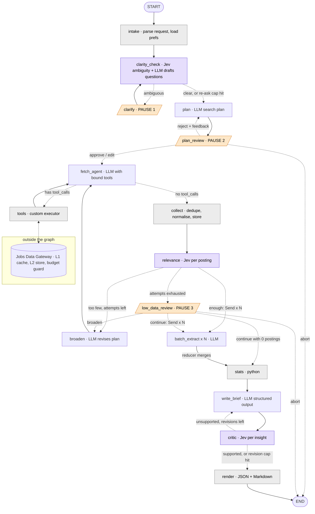

# What is the node-level graph shape?

Type: grilling
Status: resolved

## Question

What nodes, fixed edges, conditional edges and Pauses make up the StateGraph?

## Answer

Resolved during charting. Solid = fixed edge, dotted = conditional edge (label is the router outcome). Exact caps (re-asks, attempts, revisions) are LLD.

Notes:
- The `continue with 0 postings → stats` edge exists because a zero-length `Send` fan-out never reaches `stats`; without it the Run would stall silently.
- A vague answer to a Clarifying Question is re-asked at most once, then the Run proceeds with a recorded Assumption.
- Plan rejection returns to `plan` with the user's feedback; abort ends the Run cleanly.
