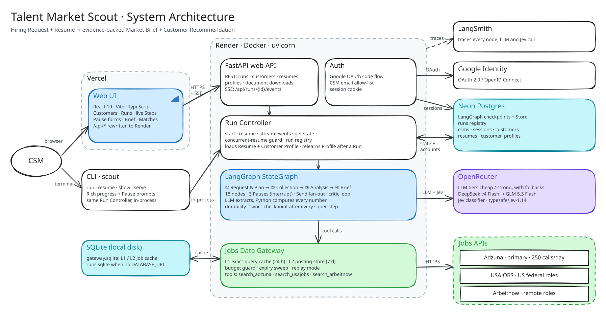
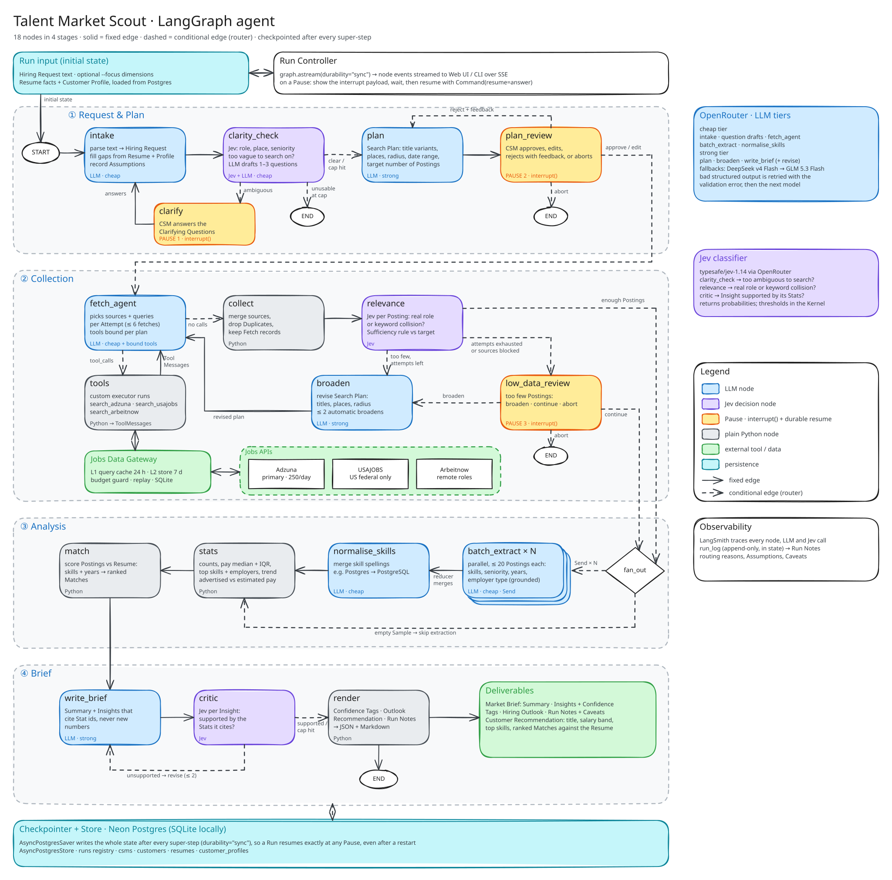

# Talent Market Scout

Talent Market Scout is an agent for customer success managers (CSMs) who look after job seekers. A CSM types a hiring request like *"Senior data analyst in Mumbai"*, optionally attaches the Customer's resume, and gets back two documents:

- A **Market Brief** on demand, pay, top skills, competition and the Hiring Outlook. Every Insight has a Confidence Tag and lists the Postings it was drawn from.
- A **Customer Recommendation** with the title, salary band and skills to aim for, and the Postings ranked against the resume.

One rule runs through the whole design: the LLM reads and Python counts. Models pull facts out of job Postings and write the prose, but every number in the Brief is computed by code from real Postings.

## How the pieces connect



Two clients sit in front of the system: a React web app and a `scout` CLI. Neither of them touches the agent directly. They both go through the **Run Controller**, which starts the LangGraph agent, streams its progress, stops at Pauses and resumes it later. The agent talks to three outside services: OpenRouter for every model call, the Jobs Data Gateway for job data, and Postgres for its checkpoints.

### The life of one Run

1. **The CSM starts a Run.** In the web app they pick a Customer, type a request (or leave it blank to work from the resume) and press start. The browser loads the app from Vercel, and Vercel forwards every `/api/*` call to the FastAPI backend on Render. FastAPI works out which CSM is calling from the session cookie (or uses the one local CSM when sign-in is off) and confirms the Customer is theirs. From the CLI, `scout run` calls the same Controller in the same process.
2. **The Controller prepares the Run.** It checks the OpenRouter balance first, so a Run can't die halfway for lack of credit. Then it reads this Customer's resume facts and learned Customer Profile from Postgres and copies them into the Run's starting state. Because they are copied in, no node can ever read another Customer's data. Next it creates a thread ID, takes a file lock on it and adds a `running` row to the run registry. Finally it starts the graph in a background task and returns the thread ID.
3. **The browser subscribes.** The web app opens `GET /api/runs/{id}/events`, a Server-Sent Events stream. The graph runs with `astream(durability="sync")`, and the Controller turns each streamed chunk into events: a node starting or finishing, tool calls, tokens and log lines. The UI groups these into the friendly Steps the CSM sees.
4. **Nodes call out as they run.** LLM nodes go to OpenRouter through the cheap or strong tier. Jev nodes go to the Jev classifier, which is also on OpenRouter. When `fetch_agent` asks for a search, the `tools` node passes it to the Jobs Data Gateway. The Gateway looks in its L1 query cache, then its L2 Posting store (both in SQLite), checks the Adzuna budget, and only then calls Adzuna, USAJOBS or Arbeitnow. The Postings return as tool messages, and `collect` merges them into state.
5. **Every step is saved.** After each super-step, LangGraph writes the whole state to Postgres, or to SQLite when run locally. LangSmith traces every node and model call along the way, and each node appends to `run_log` in state.
6. **A Pause hands control to the CSM.** A Pause node calls `interrupt()` with a payload: the questions, the plan or the low-data summary. The stream ends, and the Controller reads the pending interrupt from the saved state. It marks the Run `paused`, releases the lock and sends a `Paused` event, so the web app shows a form (the CLI prints a prompt). The CSM can close the tab and come back days later. Their answer goes to `POST /api/runs/{id}/resume`. The Controller retakes the lock, checks the answer against the Pause and resumes the graph with `Command(resume=answer)`. The paused node then runs again from the top with the answer in hand.
7. **The Run finishes.** `render` puts the finished Brief and Recommendation into state. The Controller marks the Run `done` and writes `brief.json`, `brief.md`, `recommendation.json` and `recommendation.md` under `runs/{id}/`, where the download links find them. It then rebuilds the Customer Profile from the Customer's recent finished Runs, so the next request starts with better defaults. The web app loads the Run and shows the Brief.

If anything goes wrong, the Run is recorded as `failed` and can be resumed from its last checkpoint. That also covers a server restart. The registry row is only an index, and the checkpoint is what counts, so the two are reconciled whenever a Run is read.

### Who talks to whom

| From | To | Over | Carries |
|---|---|---|---|
| Browser | Vercel | HTTPS | The static React app. `/api/*` is rewritten to Render. |
| Web app | FastAPI | JSON and SSE | Starting, resuming, cancelling and deleting Runs. Customers, resumes and profiles. The live event stream. |
| FastAPI | Google | OAuth code flow | Sign-in, when `SIGN_IN` is on. The session it creates is kept in the accounts tables. |
| FastAPI | OpenRouter | Cheap LLM tier | Parsing an uploaded resume (PDF, DOCX or text) into facts, which are stored in the `resumes` table. |
| FastAPI, CLI | Run Controller | Python calls | Start, resume, get state and stream events. |
| Run Controller | Postgres | psycopg pool | The run registry, reads of checkpoints, resumes and profiles, and the profile rebuilt after each Run. |
| Run Controller | LangGraph | `astream`, `Command` | The starting state, Pause answers and streamed chunks. |
| LangGraph | Postgres | Checkpointer and Store | The full state after every super-step. |
| LangGraph nodes | OpenRouter | LLM tiers, Jev | Extraction, planning, writing and yes/no judgements. |
| `tools` node | Jobs Data Gateway | Python calls | Search requests and normalised Postings. |
| Jobs Data Gateway | SQLite and the job APIs | Local file, HTTPS | The L1 and L2 cache, and live Adzuna, USAJOBS and Arbeitnow calls. |
| Everything | LangSmith | Tracing | Every node, LLM call and Jev call. |

### Design decisions

The code is split by concern into eight components. Each one owns one part of the graph state, and no component writes another's part.

| Component | Owns |
|---|---|
| Kernel | The state schema, domain types, LLM tiers, the Jev wrapper and every threshold. It also owns `run_log`, which every node appends to. |
| Jobs Data Gateway | Everything between the search tools and the job APIs: caching, budget, expiry and replay. It sits outside the graph. |
| Request & Plan | The Hiring Request, Clarifying Questions, Assumptions and the Search Plan. |
| Collection | Fetching, deduplicating and judging Postings, plus Sufficiency and broadening. |
| Analysis | Per-Posting extractions, skill merging, Stats and resume Matches. |
| Brief | The draft, the critic and the final JSON and Markdown. |
| Runtime | Graph wiring, the checkpointer and Store, the Run Controller, events and the Pause protocol. |
| Clients | The CLI, the FastAPI app and the React UI. |

Models extract and code computes. An LLM reads each Posting for skills, seniority, years of experience and employer type, and code throws away any fact that isn't in the Posting's text. Counts, medians, shares, Confidence Tags and the Hiring Outlook are all set in Python. The writer only cites Stat IDs, so it can't make up a number. Advertised, estimated and federal pay are never mixed together.

Jev is used only where code can't decide. It answers three yes/no questions: whether a request is clear enough to search, whether a Posting is really the role, and whether an Insight is supported by the Stats it cites. Each answer comes with probabilities, so all the cut-offs sit in one file. Whether there are enough Postings (Sufficiency) is a plain rule, not a model's opinion.

Model calls go through two tiers. The cheap tier handles bulk work like intake, extraction and tool calling. The strong tier handles planning, broadening and writing. Each tier falls back to its next model, and a malformed structured reply is retried with the validation error included.

The Gateway exists to protect a small Adzuna quota. Its caches make repeat Runs, tests and offline replays free, and its budget guard refuses a call before the daily limit rather than after.

Pauses have to survive anything. Each Pause node makes a single `interrupt()` call and does nothing else, so running it again on resume is harmless. Checkpoints are written synchronously, and a file lock stops two processes from resuming the same Run at once.

In production, the React build is on Vercel, FastAPI runs in Docker on Render, and Neon Postgres holds checkpoints, the Store, the registry and the accounts tables. Locally the same code runs entirely on SQLite.

For the full reasoning, see [docs/HLD.md](docs/HLD.md) and the per-component design docs in [docs/lld](docs/lld).

## The LangGraph agent



Solid arrows are fixed edges, and dashed arrows are decisions made by a router. Blue nodes call an LLM, purple nodes ask Jev, orange nodes are Pauses that wait for the CSM, and grey nodes are plain Python.

### Request & Plan

| Node | What it does |
|---|---|
| `intake` | Turns free text into a Hiring Request: role, location, seniority, work mode and currency. Gaps are filled from the resume and the Customer Profile, and each fill is recorded as an Assumption. |
| `clarity_check` | Jev decides whether the role, place or seniority is too vague to search on. If so, an LLM drafts 1 to 3 Clarifying Questions. A request that is still unusable after two asks ends the Run. |
| `clarify` (Pause 1) | Calls `interrupt()` with the questions. The answers go back to `intake`. |
| `plan` | The strong tier writes the Search Plan: title variants, places, radius, date range and how many Postings to aim for. |
| `plan_review` (Pause 2) | The CSM approves the plan, edits it, rejects it with feedback (which sends it back to `plan`) or aborts. |

### Collection

| Node | What it does |
|---|---|
| `fetch_agent` | A tool-calling LLM chooses sources and queries, up to 6 fetches per Attempt. Its tools are `search_adzuna`, `search_arbeitnow` and, for US plans only, `search_usajobs`. |
| `tools` | A small custom executor that runs each tool call through the Gateway and returns `ToolMessage`s. The prebuilt `ToolNode` isn't used because LangChain keeps changing its internals. |
| `collect` | Merges the sources, drops Duplicates and keeps a record of each fetch. |
| `relevance` | Jev checks every Posting to tell the real role apart from a keyword match. A rule then compares the Relevant Postings with the plan's target. |
| `broaden` | The strong tier loosens the plan's titles, places or radius, and sends it back to `fetch_agent`. This happens at most twice without asking. |
| `low_data_review` (Pause 3) | There are still too few Postings, so the CSM chooses to broaden again, continue with what there is, or abort. |

### Analysis

| Node | What it does |
|---|---|
| `fan_out` (router) | Splits the Sample into Batches and sends each one to its own `batch_extract` with `Send`. An empty Sample skips straight to `stats`. |
| `batch_extract` × N | Runs in parallel, with up to 20 Postings per Batch. The cheap tier pulls out skills, seniority, years and employer type, and code drops anything it can't find in the text. A reducer merges the Batches. |
| `normalise_skills` | One LLM call groups spellings of the same skill, such as *Postgres* and *PostgreSQL*. |
| `stats` | Pure Python: counts, median salary and the middle 50%, top skills and employers, and the posting-date trend. |
| `match` | Pure Python: scores each Posting against the resume on skills and years, then ranks them. |

### Brief

| Node | What it does |
|---|---|
| `write_brief` | The strong tier writes the Summary and Insights. They can cite Stat IDs but not new numbers. |
| `critic` | Jev asks whether each Insight is backed by the Stats it cites. Unsupported Insights go back for a rewrite, at most twice. |
| `render` | Code sets the Confidence Tags, the Hiring Outlook and the Customer Recommendation, builds the Run Notes from `run_log`, and renders everything as JSON and Markdown. |

If a node is killed partway through, only that node runs again from the last checkpoint. Any searches it repeats come from the Gateway's cache and cost no API calls.

## Setup and running

You need Python 3.12, [uv](https://docs.astral.sh/uv/) and Node 20 or later.

1. Create a `.env` file in the repo root with `OPENROUTER_API_KEY`, `ADZUNA_APP_ID`, `ADZUNA_API_KEY`, `USAJOBS_API_KEY`, `USAJOBS_USER_AGENT` and the `LANGSMITH_*` keys. `DATABASE_URL` is optional. Without it, Runs are stored in local SQLite.
2. Install the dependencies:

```bash
uv sync
```

3. Start a Run from the CLI:

```bash
uv run scout run "Senior data analyst in Mumbai" --focus compensation
```

4. Pick up a paused Run:

```bash
uv run scout resume
```

5. To use the web app instead, start the API on port 8000:

```bash
uv run scout serve
```

6. Then start the UI on port 5173. Vite forwards `/api` to the API.

```bash
cd web && npm install && npm run dev
```

7. To try the UI without any API keys, run the scripted demo graph:

```bash
uv run scout serve --demo
```

8. Run the tests:

```bash
uv run pytest
```

## Answering the Pauses

A Run can stop at up to three Pauses. Its state is saved at each one, so you can close the CLI or the browser and answer later. To carry on, run `scout resume` or open the Run again in the web app.

| Pause | When it appears | CLI | Web UI |
|---|---|---|---|
| Clarify | The role, place or seniority is too vague to search on. | Type an option's number or your own answer, or press Enter to skip the question. | Pick a suggested answer or type your own, then click **Send answers**. If you leave every answer blank, the button reads **Continue without answering**. |
| Plan review | On every Run, once the Search Plan is drafted. | `[a]` approve, `[e]` edit, `[r]` reject or `[x]` abort. Edit opens the plan as JSON in `$EDITOR` (Notepad by default), and an invalid edit reopens with the errors at the top. Reject asks what should change. | **Approve**, **Edit** (opens a form), **Ask for a different plan** (with your feedback) or **Abort**. |
| Low data | Three Attempts found fewer Relevant Postings than the target, or the sources are blocked or out of budget. | `[b]` broaden, `[c]` continue with what was found, or `[x]` abort. Broaden asks for optional guidance and whether to search the whole country. | **Search wider** (with optional guidance and a "Search the whole country" box), **Continue with N Postings** or **Abort**. |

A vague answer is asked about once more. After that the Run goes ahead with the value as given and records an Assumption. The exceptions are a request with no role at all or a country no source covers, which end the Run. Continuing with zero Postings still produces a Brief, and the Brief explains why it has no figures.

## Known limitations

- Job sites list openings, not candidates. The Hiring Outlook estimates the market from demand pressure, and the Brief says so.
- Adzuna cuts descriptions to 500 characters, so skills come from snippets. Many Adzuna salaries are Adzuna's own estimates (`salary_is_predicted`). They're reported separately from advertised pay and never counted as disclosed.
- USAJOBS only has US federal roles. Arbeitnow only has remote roles, and a remote Posting doesn't mean the employer can hire in your country. Each Run covers a single country.
- The Adzuna free tier allows only a limited number of calls a day, and the budget guard refuses calls before the limit. Commercial use needs an Adzuna licence after the 14-day evaluation.
- Every Jev threshold starts at 0.5. The Outlook and Confidence thresholds were checked on only one role. Tuning both needs a labelled evaluation set.
- To keep costs down, both tiers run DeepSeek v4 Flash with GLM 5.3 Flash as the fallback. You can set production models through `LLM_CHEAP` and `LLM_STRONG`.
- Pay in other currencies is converted at ECB rates from a fixed date, not live rates. The Brief notes this as a Caveat.
- The Gateway's cache lives on local disk. Render wipes that disk on every restart, so the cache starts cold. Runs themselves are safe in Postgres.
- The Render free instance sleeps when idle, so the first request after a quiet spell is slow. The web app shows a waking notice while it waits.
- After a page reload, the web app rebuilds the Run's state but not the tokens that were streamed. Closing the CLI mid-node stops the Run, and `scout resume` restarts it from the last checkpoint.
- Only text-based PDF, DOCX and plain-text resumes can be read. Scanned files aren't supported because there is no OCR. Contact details are redacted.
- Sign-in is off by default. Unless `SIGN_IN=true` and `ALLOWED_EMAILS` are set, every visitor shares one local CSM account, so turn sign-in on before you share a hosted URL.

## Repository map

```
src/talent_scout/
  kernel/        state schema, domain types, LLM tiers, Jev wrapper, thresholds
  gateway/       Adzuna, USAJOBS and Arbeitnow clients, L1/L2 cache, budget guard, replay
  request_plan/  intake · clarity_check · clarify · plan · plan_review
  collection/    fetch_agent · tools · collect · relevance · broaden · low_data_review
  analysis/      batch_extract · normalise_skills · stats · match, resume parsing
  brief/         write_brief · critic · render, outlook and confidence rules
  runtime/       graph wiring, Run Controller, registry, accounts, Pause protocol
  clients/       CLI, FastAPI app, auth, customers, resumes, profiles
web/             React front end
samples/         three end-to-end example Runs (brief, transcript, trace)
docs/            HLD, per-component LLDs, diagrams (.excalidraw sources)
```

The diagrams are editable: open the `.excalidraw` files in [docs/diagrams](docs/diagrams) at [excalidraw.com](https://excalidraw.com). Domain terms like Posting, Sample and Caveat are defined in [GLOSSARY.md](GLOSSARY.md).
