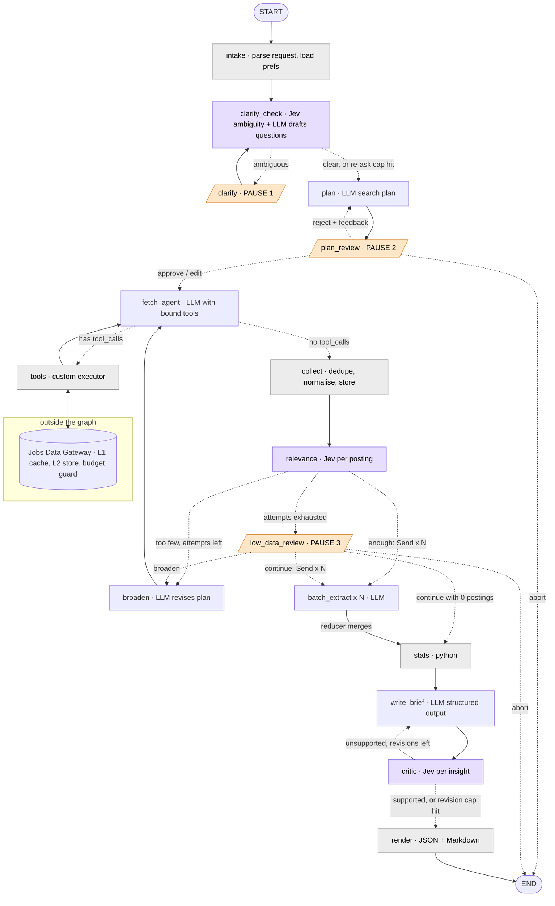
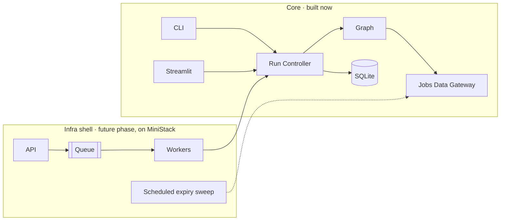

# Talent Market Scout: High-Level Design

The Talent Market Scout turns a **Hiring Request** into an evidence-backed **Market Brief**. A customer success manager can hand the brief to a client. Vocabulary follows [GLOSSARY.md](../GLOSSARY.md). Each decision below is a short summary that links to the ticket holding its full reasoning.

## 1. Scope

This HLD fixes the components, the graph shape, which component owns which part of the state, Pauses and durable resume, where Jev is used, the data gateway, the infra topology and the build order. Each component gets its own LLD/build effort, which decides exact state fields and types, prompt text, retry counts, limits, thresholds, and library and model picks. ([What does the HLD cover?](../.scratch/talent-scout-hld/issues/01-hld-destination-and-lld-deferral.md))

Out of scope: the supervisor multi-agent stretch goal.

## 2. System context

```mermaid
flowchart LR
  user([CSM / user])
  subgraph clients [Clients]
    cli[CLI]
    st[Streamlit · optional]
  end
  rc[Run Controller]
  graph[LangGraph StateGraph]
  db[(SQLite · checkpointer + Store)]
  gw[Jobs Data Gateway]
  adz[Adzuna API]
  usa[USAJOBS API]
  orr[OpenRouter · LLMs + Jev]
  ls[LangSmith]

  user --> cli & st --> rc --> graph
  rc <--> db
  graph <--> db
  graph --> gw --> adz & usa
  graph --> orr
  graph -.traces.-> ls
```

- **Stack**: Python, LangChain + LangGraph, OpenRouter for every LLM call and for Jev, LangSmith tracing. API keys live in the root `.env`.
- **Jobs sources**: Adzuna is the primary source. USAJOBS is used only for US locations and covers federal roles only. The model reaches both through LangChain `@tool`s and never calls the APIs directly. ([Jobs sources and tool execution](../.scratch/talent-scout-hld/issues/03-jobs-sources-and-tool-execution.md))
- **Clients call only the Run Controller.** It offers four operations: start, resume, stream events and get state. Clients never touch the graph directly. ([Client surfaces and the Run Controller](../.scratch/talent-scout-hld/issues/09-client-surfaces-and-run-controller.md))

## 3. Components

The system is split by concern, not one component per node. The Kernel declares each part of the state, and each part has exactly one component that writes it. ([Component breakdown and build order](../.scratch/talent-scout-hld/issues/16-component-breakdown-and-build-order.md))

| # | Component | Responsibility | Part of state it writes |
|---|---|---|---|
| A | **Kernel** | State schema and reducers, domain types, LLM tier factory, Jev classifier wrapper and all Jev thresholds | `run_log` (append-only; every node writes to it) |
| B | **Jobs Data Gateway** | Adzuna and USAJOBS clients, L1 cache, budget guard, replay mode, expiry and sweep; the L2 store comes later | none (outside the graph) |
| C | **Request & Plan** | `intake`, `clarity_check`, `clarify` ⏸, `plan`, `plan_review` ⏸ | Hiring Request, Clarifying Questions and answers, Assumptions, Search Plan |
| D | **Collection** | `@tool`s, `fetch_agent`, `tools` executor, `collect`, `relevance`, Sufficiency rule, `broaden`, `low_data_review` ⏸ | tool messages, Postings, Sample, attempt count |
| E | **Analysis** | `batch_extract` (Send fan-out and its reducer), `stats` | per-Posting extractions, stats |
| F | **Brief** | `write_brief`, `critic`, `render`, building the Run Notes from `run_log` | brief draft, critic verdicts, final JSON and Markdown |
| G | **Runtime** | Graph wiring and compile, SQLite checkpointer and Store, run registry, Run Controller, event stream, Pause protocol, concurrent-resume guard | nothing in graph state; owns threads and the registry |
| H | **Clients** | CLI (Pause UX, `--resume`, `--focus`, progress); Streamlit later | none |
| I | **Long-term memory** | Preferences namespace in the Store, read by `intake` | preferences |
| J | **Infra shell** *(future phase)* | API, queue and workers on MiniStack, wrapping the Run Controller | none |

Boundary rules:
- No component writes another component's part of the state.
- Pause nodes live with the stage whose decision they gate. Runtime owns the Pause *protocol*: the payload shape, re-showing the Pause on return, and resuming.
- Graph wiring lives in Runtime. Stage components export only nodes and router functions.
- Critic, streaming and Run Notes are later passes over existing components, not separate components.

## 4. Graph

Solid lines are fixed edges and dotted lines are conditional edges (each label is the router's outcome). Orange nodes are Pauses, purple nodes are Jev decisions and grey nodes are plain code. Exact caps (re-asks, attempts, revisions) are set in the LLDs. ([Graph shape](../.scratch/talent-scout-hld/issues/06-graph-shape.md))



- The `continue with 0 postings → stats` edge exists because a `Send` fan-out with zero branches never reaches `stats`. Without the edge, the Run would stall silently.
- A vague answer to a Clarifying Question is re-asked at most once. After that, the Run proceeds and records an Assumption.
- **Tool execution** uses a custom executor node: it reads `tool_calls`, dispatches each by name and returns `ToolMessage`s. The prebuilt `ToolNode` is not used, to insulate the graph from churn in LangChain's internals. Research confirmed that churn: `create_react_agent` is deprecated and `langchain` no longer re-exports `ToolNode`. ([Jobs sources and tool execution](../.scratch/talent-scout-hld/issues/03-jobs-sources-and-tool-execution.md), [LangGraph persistence research](../.scratch/talent-scout-hld/issues/15-research-langgraph-persistence-and-resume.md))

## 5. LLM vs code

([What does the LLM do versus code?](../.scratch/talent-scout-hld/issues/05-llm-extracts-code-computes.md))

- **The LLM extracts per-Posting facts**: skills, seniority, must-have vs nice-to-have, years of experience.
- **Python computes every number**: counts, salary median and middle 50%, pay-disclosure share, top employers, posting-date trend. `stats` is a fixed node, not a tool. There is no decision for a model to make there, and a tool would add nondeterminism, tokens and a failure mode.
- The brief writer receives the precomputed stats and Posting IDs. It chooses and phrases Insights but never invents figures.
- **Sufficiency** is a rule (count of Relevant Postings vs the Search Plan's target, with capped attempts), not an LLM opinion.

**LLM tiers**: every LLM call goes through OpenRouter. A cheaper tier handles batch extraction and question drafting; a stronger tier handles planning, brief writing and critique. Each tier has a `.with_fallbacks()` chain. When structured output is malformed, the call is retried with the validation error fed back, then falls back to the next model. The models themselves are chosen in LLD. ([LLM tiering and fallbacks](../.scratch/talent-scout-hld/issues/08-llm-tiering-and-fallbacks.md))

**Prompt caching** is a rule for building prompts, not a component: stable instructions and the schema come first, so batch calls share a cached prefix.

## 6. Jev placements

Jev is used only for semantic judgements that cannot be computed. ([Jev placement](../.scratch/talent-scout-hld/issues/07-jev-placement.md))

1. **Clarity check**: is the role, location or seniority too ambiguous to search on? This decides between clarifying and skipping ahead. An LLM still drafts the questions themselves.
2. **Posting relevance**: is this Posting really the researched role, or a keyword collision? Only Relevant Postings count toward Sufficiency.
3. **Critic** (stretch): is each Insight supported by the Postings it cites? This drives the revise loop.

All thresholds live in one place (the Kernel) and are tuned per model, because Jev's calibration does not transfer between models.

**Access**: `typesafe/jev-1.14` on OpenRouter returns full Noul, Choice and Score probabilities. `TypeSafeClassifier` works unchanged when pointed at OpenRouter's `base_url`, using the same OpenRouter key as the LLMs. Keep each request under about 32 KB, since longer inputs switch Jev to a slower, less accurate mode; this matters most for the critic. Fallback order if that fails: the OpenRouter decisions endpoint → TypeSafe directly → an LLM with structured output (which loses the probability distributions). ([Jev on OpenRouter research](../.scratch/talent-scout-hld/issues/12-research-jev-on-openrouter.md))

## 7. Jobs Data Gateway

The gateway sits outside the graph, between the tools and the APIs, and protects a small daily Adzuna quota. ([Gateway caching and expiry](../.scratch/talent-scout-hld/issues/04-jobs-data-gateway-caching-and-expiry.md))

- **L1 exact-query cache**: maps normalised request params to the raw response, with a short TTL. This makes repeat runs, tests and replay free. Must-have.
- **L2 region × Domain Posting store** (built later): every Posting is stored, deduplicated by source ID and tagged with a region and a Domain. The region comes from Adzuna's `location.area` hierarchy. The Domain comes from Adzuna's category tag; USAJOBS job families are mapped onto the same list. Before calling the API, the gateway checks whether L2 already has enough fresh Postings for that region, Domain and role.
- **Expiry**: hard expiry applies when the source gives a close date that has passed (USAJOBS `ApplicationCloseDate`). Soft expiry applies when a Posting is older than a freshness window. Adzuna has no expiry field, so its Postings only ever soft-expire, and every Adzuna search passes `max_days_old`. Expired rows are filtered out on read, and a sweep at the start of each Run purges them.
- **Budget guard**: counts calls per source and refuses before the limit. Neither API publishes a firm quota, so the guard counts calls regardless.
- **Replay mode**: the whole graph runs from cached responses. This doubles as the test harness.

Source facts that shape the design ([Adzuna research](../.scratch/talent-scout-hld/issues/13-research-adzuna-api-facts.md), [USAJOBS research](../.scratch/talent-scout-hld/issues/14-research-usajobs-api-facts.md)):
- **Adzuna**:
  - Salaries are in local currency with no stated period.
  - `salary_is_predicted` marks salaries Adzuna estimated itself.
  - Descriptions are truncated to 500 characters, so skills Evidence comes from snippets.
  - Commercial use beyond a 14-day evaluation needs a licence.
- **USAJOBS**:
  - Federal roles only.
  - Up to 500 results per page.
  - Pay comes with rate-interval codes.
  - Federal pay comes from fixed pay tables, so it must never be mixed unlabelled into market salary stats.

## 8. Pauses and durable resume

Being able to close the client at any Pause and resume exactly there is non-negotiable. ([Persistence and durable resume](../.scratch/talent-scout-hld/issues/10-persistence-and-durable-resume.md), [LangGraph persistence research](../.scratch/talent-scout-hld/issues/15-research-langgraph-persistence-and-resume.md))

- **Backend**:
  - The SQLite checkpointer stores threads. `SqliteStore`, in the same file, stores long-term preferences and the run registry.
  - Its known limit is a single writer: fine for the CLI, and replaced in the infra phase (Postgres is the candidate).
  - `MemorySaver` was rejected because its state dies with the process.
- **Durability**:
  - The Run Controller passes `durability="sync"` on every graph call. The default `async` mode can roll a just-answered Pause back.
  - Checkpoints are written per super-step, so parallel `batch_extract` branches share one.
- **Pause nodes are pure**:
  - Each Pause node makes exactly one `interrupt()` call, never inside `try/except`, and only writes the answer.
  - Anything generative, such as drafting questions, happens in the node before. The paused node re-runs from the top when resumed.
- **Returning re-shows the same Pause**: the Run Controller loads the thread, reads the pending payload from `get_state(...).interrupts`, re-displays it and resumes with `Command(resume=answer)`.
- **Run registry**: a `("runs",)` namespace in the Store records thread, request summary, status and last-updated time. CLI `--resume` lists the resumable Runs, and Streamlit keeps the thread ID in the URL.
- **Concurrent resume guard**: LangGraph does not stop two processes from resuming the same thread at once, so the Run Controller does.
- **Kill mid-node**: only that node re-runs, and any repeated fetches are served from the L1 cache at no quota cost.

## 9. Tracing and Run Notes

LangSmith traces everything. Separately, the graph keeps a `run_log` in state: routing decisions with reasons, Clarifying Questions and answers, the final Search Plan and Assumptions. The `run_log` feeds the Market Brief's Run Notes and the `samples/` transcripts, so evaluators can follow a Run without access to LangSmith. ([Tracing and run log](../.scratch/talent-scout-hld/issues/11-tracing-and-run-log.md))

## 10. Infra topology (future phase)



- The core graph never depends on the infra shell. The shell wraps the core only through the Run Controller, which makes it an addition rather than a rewrite. ([Build priority order](../.scratch/talent-scout-hld/issues/02-build-priority-order.md), [Client surfaces and the Run Controller](../.scratch/talent-scout-hld/issues/09-client-surfaces-and-run-controller.md))
- In this phase, the per-Run expiry sweep becomes a scheduled job, and persistence moves off SQLite.
- The infra shell's own LLD decides the API surface, queue technology, worker model, threading vs async, how concurrent Runs share the daily Adzuna budget, and the web UI.

## 11. Build order

Requirement tiers come in priority order ([Build priority order](../.scratch/talent-scout-hld/issues/02-build-priority-order.md)): must-have → recommended → streaming → infra shell → critic → long-term memory.

Each component's LLD covers all of its tiers, but the build goes in **passes across components**, not one finished component at a time. ([Component breakdown and build order](../.scratch/talent-scout-hld/issues/16-component-breakdown-and-build-order.md))

1. **Must-have walking skeleton**: Kernel → Gateway (L1, budget guard, replay, Adzuna) → Runtime + CLI (SQLite and the Pause protocol from day one) → Request & Plan (clarify only) → Collection → Analysis (sequential extraction) → Brief (no critic).
2. **Recommended**: `plan_review` and `low_data_review` Pauses, Send fan-out, fallbacks, `--focus`, USAJOBS, Streamlit, Gateway L2.
3. **Streaming progress**: the Runtime event stream, rendered by the clients.
4. **Infra shell** (J).
5. **Critic pass** (F).
6. **Long-term memory** (I).

After that come the `samples/`, README and write-up, as a delivery task.

## 12. Deferred to component LLDs

| Component | Open questions |
|---|---|
| Analysis | Currency and period normalisation, treatment of `salary_is_predicted`, USAJOBS vs Adzuna in compensation stats, batch sizing for large Samples |
| Brief | Rules for the Confidence Tag and the Hiring Outlook |
| Jobs Data Gateway | Whether Adzuna's histogram, top_companies and history endpoints feed the brief (they carry no Posting IDs, so they are not strict Evidence) |
| Request & Plan, Clients | What each `--focus` flag changes |
| Runtime | Streaming event model |
| Long-term memory | Which preferences are remembered, and whether they are learned or asked |
| Infra shell | Everything listed in §10 |
| Delivery | Choosing the three sample runs within the Adzuna budget |
