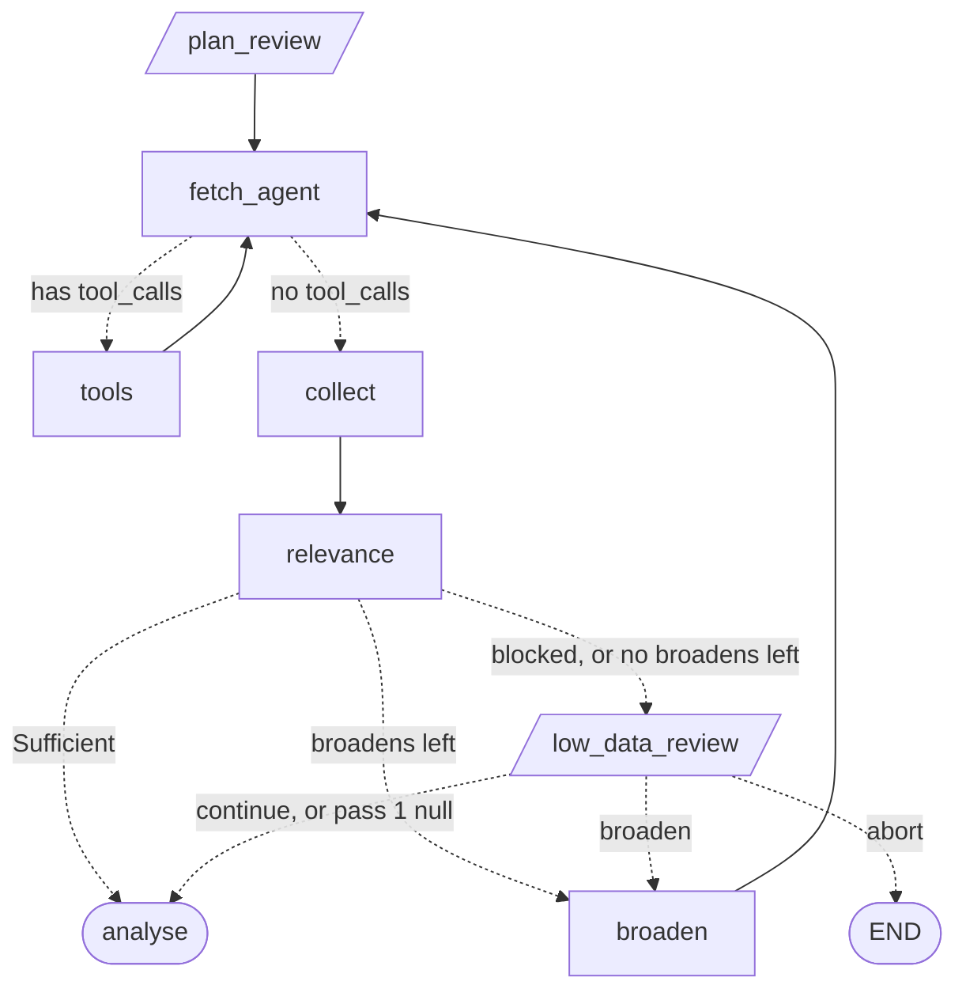

# Collection LLD

The low-level design of Collection (component D in [HLD](../HLD.md) §3), precise enough to build from. Items marked ⏳ belong to the named LLD. Deliberate deferrals live in [future-scope.md](future-scope.md). Shared types, `owned()`, Tiers and Jev come from the [Kernel LLD](kernel.md). The stage contract and Pause protocol come from the [Runtime LLD](runtime.md). `Fetch`, `coalesce` and the errors come from the [Gateway LLD](gateway.md).

Source tickets (each holds the full reasoning):
- [The fetch agent and its source tools](../../.scratch/collection-lld/issues/01-fetch-agent-and-search-jobs.md)
- [What Relevant means and how it is judged](../../.scratch/collection-lld/issues/02-relevance.md)
- [Sufficiency, broaden and blocked Attempts](../../.scratch/collection-lld/issues/03-sufficiency-broaden-and-blocked-attempts.md)
- [The low_data_review Pause](../../.scratch/collection-lld/issues/04-low-data-review.md)
- [Who builds the Sends](../../.scratch/collection-lld/issues/05-who-builds-the-sends.md)
- [Caveats](../../.scratch/collection-lld/issues/06-caveats.md)
- [Prompts](../../.scratch/collection-lld/issues/07-prompts.md)

## 1. What Collection is

It turns an approved Search Plan into a Sample of Relevant Postings, broadening within a fixed limit and pausing when it can't get enough.

It owns:
- the `search_adzuna` and `search_usajobs` tools, tool args → `Fetch`, and which tools are bound to the model
- the nodes `fetch_agent`, `tools`, `collect`, `relevance`, `broaden`, `low_data_review` and their routers
- the Sufficiency rule and the attempt cap
- what Relevant means
- `FetchRecord`, and the payload and answer fields of the `low_data_review` Pause
- the Caveats in §11

It does **not** own:
- `SearchPlan` and its limits (Kernel §3, [Request & Plan LLD](request-plan.md) §6)
- `Fetch`, `coalesce`, the per-source call or the budget guard (Gateway)
- `fan_out`, batching and federal pay in Stats (⏳ Analysis)
- rendering Caveats and the `total` disclosure (⏳ Brief)

## 2. Layout

```
src/talent_scout/collection/
  types.py      # FetchRecord, LowDataPayload, LowDataAnswer
  prompts.py    # FETCH_SYSTEM, BROADEN_SYSTEM, the relevance Noul
  nodes.py      # make_nodes(deps), ROUTERS, MAX_FETCHES, MAX_BROADENS
```

`types.py` exists as a stub at this path from the Runtime build. It imports `kernel.types` and `gateway.types`. `gateway/types.py` imports only `kernel.types`, so it has the same standing as a stage `types.py`, and nothing loops.

```python
MAX_FETCHES = 6     # per Attempt; 3 Attempts spend at most 18 of Adzuna's 25 daily calls, retries aside
MAX_BROADENS = 2    # so 3 Attempts before low_data_review
```

## 3. Types and state

```python
# collection/types.py
class FetchRecord(Model):
    attempt: int                  # len(broadened_plans) when it ran
    source: Source                # the tool the model called
    fetch: Fetch
    result: FetchResult | None    # None when the source failed
    error: str | None             # the GatewayError text

class LowDataPayload(Model):
    count: int                    # len(sample)
    target: int
    attempts: int
    plans: list[SearchPlan]       # every plan tried, oldest first
    fetched: int                  # len(postings)
    rejected: int
    calls_left: int | None        # Adzuna's, at the moment of the Pause
    blocked: str | None           # fetch_blocked

class LowDataAnswer(Model):
    action: Literal["broaden", "continue", "abort"]
    guidance: str | None = None   # feeds the next broaden
```

Added to `State`, owned by Collection:

```python
fetches: list[FetchRecord] = []
relevance_verdicts: dict[str, bool] = {}      # Posting key -> Relevant
fetch_blocked: str | None = None
low_data_decision: Literal["broaden", "continue", "abort"] | None = None
low_data_guidance: str | None = None
```

| Key | Written by | On loops |
|---|---|---|
| `messages` | `fetch_agent`, `tools` | `[]` on each `broaden` |
| `fetches` | `tools` appends, `collect` strips Postings | kept across Attempts |
| `postings` | `collect` | kept across Attempts |
| `relevance_verdicts` | `relevance` | kept across Attempts |
| `sample`, `fetch_blocked` | `relevance` | recomputed each Attempt |
| `broadened_plans` | `broaden` appends | |
| `low_data_decision`, `low_data_guidance` | `low_data_review` | replaced at each review |

**Why `FetchRecord`.** `FetchResult` alone can't say which Fetch or tool it answered, and a call where the source failed has no result at all. The record gives `broaden` what each title found, gives `fetch_agent` what's already been searched, and gives `relevance` the all-failed signal. It survives a real checkpoint under strict msgpack, including `FetchResult`'s `Source`-keyed dicts (checked offline on the pinned versions).

**The Attempt number** is `len(broadened_plans)`, so there is no counter to drift, and a user-driven `broaden` counts like any other.

## 4. Flow



```python
def after_fetch_agent(state):
    return "tools" if getattr(state.messages[-1], "tool_calls", None) else "collect"

def after_relevance(state):
    if len(state.sample) >= state.current_plan.target_postings: return "analyse"
    if state.fetch_blocked or len(state.broadened_plans) >= MAX_BROADENS: return "low_data_review"
    return "broaden"

def after_low_data(state):
    if state.low_data_decision == "abort": return END
    return "broaden" if state.low_data_decision == "broaden" else "analyse"
```

**`"analyse"` isn't a node.** `Send` payloads and batching belong to Analysis, and a stage imports only `runtime/deps.py` and `runtime/pause.py`. So `runtime/graph.py` turns the outcome into `analysis.fan_out(state)`, which also sends zero Postings to `stats` (Runtime §4).

## 5. Fetching

### `search_adzuna` and `search_usajobs`

```python
async def _search(source, title, page, plan, attempt) -> FetchRecord:
    fetch = Fetch(title=title, page=page, country=plan.country, location=plan.location, radius_km=plan.radius_km,
                  max_days_old=plan.max_days_old, category=plan.category)
    try:
        return FetchRecord(attempt=attempt, source=source, fetch=fetch, result=await deps.gateway.fetch(fetch, source), error=None)
    except GatewayError as e:
        return FetchRecord(attempt=attempt, source=source, fetch=fetch, result=None, error=str(e))

@tool
async def search_adzuna(title: str, plan: Annotated[SearchPlan, InjectedToolArg], attempt: Annotated[int, InjectedToolArg], page: int = 1) -> FetchRecord:
    """Search Adzuna, a worldwide aggregator of private-sector job ads, by title. Metered: a small daily quota shared by every Run, so spend calls on titles that matter. One call returns one page of up to 50."""
    return await _search(Source.adzuna, title, page, plan, attempt)

@tool
async def search_usajobs(title: str, plan: Annotated[SearchPlan, InjectedToolArg], attempt: Annotated[int, InjectedToolArg], page: int = 1) -> FetchRecord:
    """Search USAJOBS, the US federal government's own job ads, by title. US searches only. Free and unmetered, but federal roles only, so a private-sector title may return little. One call returns one page of up to 50."""
    return await _search(Source.usajobs, title, page, plan, attempt)
```

- **The model chooses the tool, `title` and `page`.** `InjectedToolArg` hides `plan` and `attempt` from its schema (checked offline), so it can't drift from the plan the user approved. The title may be any string, not only one from the plan, because judging variants is the point of having an agent.
- **Bound per plan:** `[search_adzuna, search_usajobs]` when `current_plan.country == "us"`, else `[search_adzuna]`. The model is never offered a tool that can't work, and `tools` treats a call to an unbound name as an unknown tool.

**Why two tools.** The spec evaluates tool calling, where the model decides which tool to use. The choice has to be the model's, or the eval has nothing to see.
- **A router inside one tool hides the decision.** The trace would show one generic search call, and which API ran would be code. Two tools put the choice in the model's tool call, visible in LangSmith.
- **A `source` argument would be a parameter, not a tool.** It's the same hidden-schema problem in a smaller form, and it forces one description to cover two APIs that differ.
- **The APIs genuinely differ, so the choice is real.** Adzuna is worldwide, private-sector, honours every plan field, and has a quota of 25 calls a day. USAJOBS is US-only, federal-only, ignores `category`, and is free. Each docstring says so, and the model weighs it: a federal-adjacent role starts at USAJOBS, a private-sector title at Adzuna, and a low `calls_left` favours free calls.
- **The Gateway stays simple.** `fetch(f, source)` calls one source. L1 keys, replay files and the budget guard were already per source, so nothing there changes.
- **The cost is a weaker guarantee.** A cheap model may skip USAJOBS on a US Run, and the Sample would carry less federal evidence. `FETCH_SYSTEM` tells it to try both on a US Run's primary title, and the "Mostly federal" Caveat already covers the other tilt. The cap of 6 is now shared, so a US Run searching both sources covers three titles instead of six.

### `fetch_agent` (cheap tier)

`tiers.chat("cheap", tools=[...], name="fetch_agent")`, with the tool list chosen from `current_plan.country` and bound on each call.

- **First turn of an Attempt** (`messages` empty): writes a `SystemMessage` and a `HumanMessage`, then the reply. The `HumanMessage` holds `current_plan`, the raw goal of 1.5 × `target_postings`, the Sample so far, and what's already been searched under these same settings (§9).
- **Later turns:** sends `messages` and appends the reply.
- **At the cap:** when `messages` holds `MAX_FETCHES` or more `ToolMessage`s, it returns a `note` and makes no LLM call. The last message is then a `ToolMessage`, so the router goes to `collect`.
- **No tool call on an Attempt's first turn** is a normal Attempt with a logged `warning`, rather than a retry path for something rare.

`LLMExhausted` propagates.

### `tools`

A custom executor, as HLD §4 requires:

```python
async def tools(state):
    calls = state.messages[-1].tool_calls
    left = MAX_FETCHES - _tool_count(state)
    outcomes = await asyncio.gather(*(_run(c, state) if i < left else _refused(c) for i, c in enumerate(calls)))
    ...
```

| Case | Result |
|---|---|
| Good call | `FetchRecord` appended, summary `ToolMessage` |
| `GatewayError` (the source failed) | `FetchRecord` with `error`, `ToolMessage` with that text |
| Unknown tool, or a `ValidationError` from the args or `Fetch` | `ToolMessage` with `status="error"`, no record |
| Over `MAX_FETCHES` | `ToolMessage` refusing it, no record |
| `SourceRejected`, a bug | Propagates and stops the Run |

- The tool is looked up by name among the tools bound this Attempt, and the call runs as `tool.ainvoke({**call["args"], "plan": plan, "attempt": attempt})`. Injected values go last so model output can't override them. Invoked with plain args, a tool returns the raw `FetchRecord` rather than a message (checked offline).
- **Every `ToolMessage` counts toward the cap,** including refusals and bad args, so the count stays one line.
- **Rerun on a kill:** repeated Fetches are L1 hits at no quota cost (HLD §8).

**Summary for the model.** Postings stay out of `messages`: 50 at up to 500 characters each, per call, is what the cap exists to avoid repeating. `ToolMessage.artifact` is untyped, so strict msgpack blocks models there too. The content is:

```
adzuna "data analyst" page 1: 50 Postings, 38 new.
About 3,200 matches, 17 calls left.
Sample titles: Data Analyst II; Senior Data Analyst; BI Analyst.
```

A failed call replaces the middle lines with `adzuna failed: <failure>.` Only `adzuna` shows `calls left`.

"New" means not yet in `postings` or in an earlier record of this Attempt. At most 5 sample titles.

**Pass 3:** the executor emits `{"type": "tool_called", "name": "search_adzuna", "summary": '"data analyst" page 1'}` and `{"type": "tool_returned", "name": "search_adzuna", "summary": "50 Postings, 38 new"}`, or the error text, through the Kernel's `emit()`.

## 6. `collect`

Plain code. It reads the current Attempt's records and writes `postings`.

```python
fresh = [p for r in current if r.result for p in r.result.postings]
by_key = {**{p.key: p for p in fresh}, **state.postings}    # first copy seen wins (Kernel §5)
kept, merged = coalesce(list(by_key.values()))
```

- **By key first.** `coalesce` would otherwise record a Posting as its own Duplicate, or keep both copies when there's no employer.
- **Strips the Postings from those records,** since they're now safe in `postings`, and a second copy would be rewritten into every later checkpoint. Everything else on the record stays.
- **The mappers already normalised,** so `collect` does nothing further, despite HLD §4's older label.
- Writes a `note` with the count kept and the Duplicates merged, and a `note` with the source totals (§11).

## 7. `relevance`

### What Relevant means

A Posting is Relevant if it's really the researched **role**, at any seniority and in any location the search returned. For "Senior Data Analyst, Bangalore":

| Posting | Relevant |
|---|---|
| "Data Analyst", no level | Yes |
| "Junior Data Analyst" | Yes |
| "Data Entry Analyst" | No |
| A FAA "Public Notice" talent pool | No: not an advertisement for the role |

Judging seniority too would empty the Sample of unlevelled Postings and bias the seniority mix, which is itself a reported Dimension.

### Judging

For each key in `postings` with no verdict, one `jev.judge("relevance", state, {"relevant": RELEVANT_NOUL})`, under `asyncio.gather`, with the Kernel's semaphore limiting concurrency.

- **State sent:** `role` and `seniority` from `hiring_request`, and the Posting's `title`, `company`, `domain` and `description`.
- **One request per Posting.** 500 Postings cost under a cent at $0.042/M, and a shared request has to fit the 32 KB limit, which USAJOBS descriptions of up to 4,000 characters use up quickly.
- **Verdicts are kept across Attempts.** They judge against `hiring_request`, which doesn't change, so later Attempts judge only new Postings.
- **The Sample is `[k for k in postings if relevance_verdicts[k]]`.** It draws on every Attempt, including Postings a later plan wouldn't have found. It isn't capped when it overshoots the target; large Samples are Analysis's batching problem.

Errors from Jev that survive its own retries and fallback propagate, and `scout resume` reruns the node.

### `fetch_blocked`

Written on every pass, because it decides whether broadening can help:

| Reason | Condition |
|---|---|
| "Every search in this Attempt failed: <error>" | The Attempt has records, and all of them have `error` |
| "Adzuna's daily limit is used up, until the next UTC day" | `gateway.calls_left(Source.adzuna) == 0`, `current_plan.country != "us"`, and `replay_cache` isn't set |

Otherwise it's `None`. A US Run carries on, because USAJOBS still answers. The budget check is skipped under replay, or a recorded Run could take a different route when replayed.

`failures` can't carry this, because it holds plain strings, and `fetch` raises with no result when the source fails.

## 8. Sufficiency

`len(sample) >= current_plan.target_postings`, as in `after_relevance`. There is no separate noise rule, since noise already shows up as too few Relevant Postings. USAJOBS counts the same as Adzuna: they're real open jobs, and filtering them would discard the only Evidence some roles have. A Caveat fires when they dominate (§11).

## 9. `broaden` (strong tier)

`tiers.structured("strong", SearchPlan, system=BROADEN_SYSTEM, name="broaden")`. Afterwards code pins two fields:

```python
plan = draft.model_copy(update={"country": current.country, "target_postings": current.target_postings})
return {"broadened_plans": [*state.broadened_plans, plan], "messages": [], **log(...)}
```

The model can't then reach Sufficiency by lowering the target, or leave the market the user asked about. Both pinned values are already valid, so nothing needs revalidating. The other limits are checked on the output and fed back on the retry (Kernel §12).

**Input:** `hiring_request`, the current plan, the Sample count and target, for each title and page searched its source totals, up to 10 rejected Posting titles, and `low_data_guidance` when the Pause set one.

Totals per title are what's available, since `Posting` doesn't record which title found it, and they're what matters: a title with 12 matches is exhausted, and one with 3,200 isn't.

`LLMExhausted` propagates.

**Already searched.** `fetch_agent`'s first message lists the `(source, title, page, total)` of each record whose other Fetch fields match the current plan. A repeat is a free L1 hit but still uses up one of the 6 calls, so this is what lets a new Attempt go straight to deeper pages.

## 10. `low_data_review` ⏸

```python
async def low_data_review(state):
    answer = interrupt(LowDataPause(payload=_payload(state)))
    update = {"low_data_decision": answer.action, "low_data_guidance": answer.guidance}
    # plus a `pause` log entry, and the closing Caveats (§11) when the answer is `continue`
    return {**update, ...}
```

- **`broaden` is always allowed, with no cap,** because a human drives each one, as with `plan_review` rejects.
- **It can't be refused for lack of quota.** The Controller validates an answer without seeing the payload (Runtime §5), and a user returning the next day has fresh quota while the stored Pause still says it's gone. If quota is still out, the next Attempt finds nothing new and comes back here, at the cost of one `broaden` call, one `fetch_agent` turn and no quota.
- **`calls_left` in the payload can go stale,** since a returning user sees the stored Pause. It's for information only, and nothing routes on it.
- **`abort`** goes to END. **`continue`** goes to `analyse`.
- `fan_out` sends a Sample of zero to `stats`, so a Run can continue with nothing, and the Brief says so.

**CLI:** `broaden`, `continue` or `abort`. On `broaden`, it asks for optional guidance, where Enter skips.

**Pass 1:** `make_nodes` exports a pass-through that doesn't interrupt. `low_data_decision` stays null, the router treats null as `continue`, and it still logs the closing Caveats.

## 11. Run log and Caveats

| Node | Writes |
|---|---|
| `fetch_agent` | `warning` for no tool call in an Attempt, `note` at the cap |
| `collect` | `note` with counts and Duplicates merged, `note` with source totals |
| `relevance` | `route` with the count, target and outcome, e.g. "38 of 142 Postings relevant (route: broaden)" |
| `broaden` | `note` with what changed |
| `low_data_review` | `pause` |

**Caveats** (Kernel §9):

| Caveat | Fires when | Written by |
|---|---|---|
| Postings the mapper dropped | `dropped` > 0, with the count | `collect` |
| One source failed | L2 served a partial page (the record's `failures` holds its source), or a call failed while another call in the Attempt answered | `collect` |
| Replay age | any `cache == replay`, with the oldest `fetched_at` and the number of live calls during replay | `collect` |
| Jev degraded | any `llm_fallback` or `truncated` verdict, one per Attempt with count and keys | `relevance` |
| Mostly federal | over 50% of the Sample is USAJOBS | closing |
| Old data | over half of the Sample is older than 30 days | closing |
| Broadened | any `broaden` ran, with the count and what changed | closing |
| Too few Postings | the Sample is below target | closing |

**Closing Caveats** describe the Sample that actually reaches analysis, so `_closing_caveats` runs once, when Collection is finished: in `relevance` when Sufficient, and in `low_data_review` on `continue`. Raising them at each Pause would repeat them for every broaden the user chose.

**"Old" is measured from the newest `fetched_at`,** not today. Replay ignores the TTL, and a clock in this rule would change the Caveat text, which would miss every LLM cache entry downstream.

**No Caveat for a normal L2 read,** because up to 7 days old is within the data's expected freshness.

**Source totals** are a `note`, `{title: {source: total}}`, leaving out `cache == store`, whose total isn't the source's. ⏳ Brief renders it as labelled disclosure ("Analysed 50 of about 3,200 Adzuna matches"). It is never a Stat or Evidence (Gateway §3).

Merged Duplicates are a `note`, not a Caveat (Gateway §6).

## 12. Prompts

`prompts.py` holds all text. This section fixes what each prompt gets and must do. The exact wording is tuned during the build and against real runs, and the write-up reports what changed.

| Prompt | Tier | Input | Rules |
|---|---|---|---|
| `FETCH_SYSTEM` | cheap | §5 first message | Pick the source for each search from the tool descriptions: on a US Run try both for the primary title, spend the metered one carefully, and drop a source whose results are off-role. Search each plan title, primary first. You can't see relevance, so gather about 1.5 × the target raw, stopping early when totals say a title is exhausted. Page a title only if it has more matches. Stop when you have enough or a call is refused. Don't repeat a search you've been told is done. |
| `RELEVANT_NOUL` | Jev | §7 state | "Yes" means the Posting really is this role, which is the side that must clear the bar (Kernel §11). Ignore level differences. A keyword collision ("Data Entry Analyst" for "Data Analyst") or a general talent pool is no. Set both or neither Noul criteria sides. |
| `BROADEN_SYSTEM` | strong | §9 input | The moves: more title variants, a wider radius, an older `max_days_old`, dropping `category`, a country-wide search, replacing a noisy title. Use the totals and rejected titles to pick. Follow guidance over the defaults. Keep `country` and `target_postings`; code overrides them anyway. |

Stable text comes first, as `Tiers.structured` already enforces (Kernel §12).

## 13. Test seams

`fake_deps` from Runtime §15 with `FakeGateway`, which gains `calls_left` (Gateway §15), `FakeToolChatModel` for `fetch_agent`, and `fake_classifier` for relevance. No test calls an LLM or a jobs API.

## 14. Build checklist

Request & Plan pass 1 comes first, since this stage needs the `SearchPlan` limits and `hiring_request`. Each step leaves one small `pytest` file behind.

**Pass 1:**
1. Kernel and Gateway changes: the `State` fields, `gateway/types.py` importable from `kernel/state.py`, `JobsGateway.calls_left` and `FakeGateway.calls_left`. `collection/types.py` fields. Test: `FetchRecord` and the Pause models survive the serde test from Runtime §16.
2. `search_adzuna`, `search_usajobs` and `tools`. Test: `plan` and `attempt` aren't in either bound schema, model args can't override them, a non-US plan binds only `search_adzuna` and a `search_usajobs` call is an unknown tool, each tool passes its own `Source` to `gateway.fetch`, a `GatewayError` gives a record with `error`, bad args give an error `ToolMessage`, a 7th call is refused, `SourceRejected` propagates, and no Posting text beyond sample titles reaches a message.
3. `fetch_agent`. Test with `FakeToolChatModel`: the first turn holds the plan, a turn at the cap makes no LLM call, and no tool call logs a `warning`.
4. `collect`. Test: the same key from two Attempts stays one Posting with no self-merge, a Duplicate across Fetches collapses, records lose their Postings but keep totals, and `store` totals are left out of the note.
5. `relevance`. Test with `fake_classifier`: only unjudged Postings are sent, the Sample drops a key that `coalesce` merged, both `fetch_blocked` reasons fire, a US Run isn't blocked, and replay skips the budget check.
6. `broaden`. Test: the LLM's `country` and `target_postings` are overwritten, `messages` is cleared, a bad plan passes on the feedback retry, and guidance reaches the prompt.
7. Pass-through `low_data_review`, routers, `"analyse"` in `runtime/graph.py`. Test all outcomes, then a graph test with other stages stubbed: too few Postings on the first Attempt broadens, then reaches Sufficiency.
8. Pass 1's Caveats, each with its trigger and non-trigger: dropped, replay age, Jev degraded, old data, broadened, too few.
9. Live smoke (not in CI, spends a few Adzuna calls, needs the user's OK): "Data Analyst, Bangalore". This is the first real check of the 0.5 relevance cut and of whether 1.5× raw reaches the target in one Attempt.

**Pass 2:**
1. The real `low_data_review`. Test in a one-node graph with a checkpointer: the payload's fields, each action, guidance reaching `broaden`, a further broaden past the cap returning to the Pause, and closing Caveats only on `continue`.
2. Mostly federal and One source failed Caveats, on `FakeGateway` results with `failures` and L2 partial pages.

**Pass 3:**
1. `tool_called` and `tool_returned` events. Test inside a one-node graph.

## 15. Excluded and deferred

- Deliberate deferrals are in [future-scope.md](future-scope.md).
- Handed on:
  - ⏳ **Analysis:** `fan_out(state)`: its Sends, batching, and zero Postings to `stats`. Federal pay apart from Adzuna salaries.
  - ⏳ **Brief:** every Caveat in Run Notes, the `total` disclosure, and rendering `broadened_plans`.
  - ⏳ **Delivery:** choosing sample runs so 18 worst-case Adzuna calls fit the daily limit.
