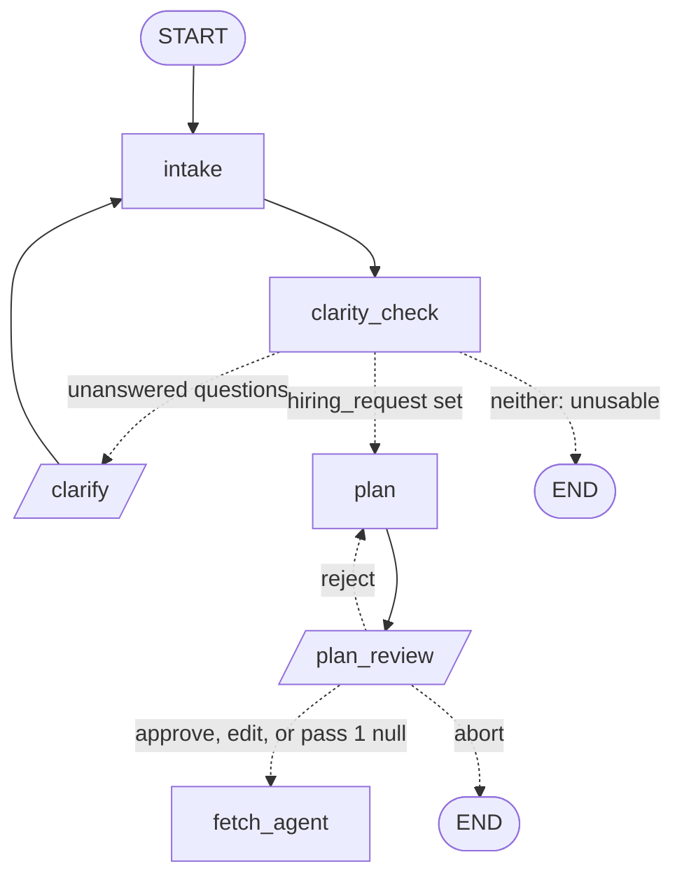

# Request & Plan LLD

The low-level design of Request & Plan (component C in [HLD](../HLD.md) §3), precise enough to build from. Items marked ⏳ belong to the named LLD. Deliberate deferrals live in [future-scope.md](future-scope.md). Shared types, `owned()`, Tiers and Jev come from the [Kernel LLD](kernel.md). The stage contract and Pause protocol come from the [Runtime LLD](runtime.md).

This LLD had no separate tickets, so the reasoning for each decision is written here.

## 1. What Request & Plan is

It turns `request_text` into a final Hiring Request and an approved Search Plan, pausing for the user only when it has to.

It owns:
- the nodes `intake`, `clarity_check`, `clarify`, `plan`, `plan_review` and their routers
- `RequestDraft`, and the payload and answer fields of the `clarify` and `plan_review` Pauses
- the rules for asking, re-asking and settling a field
- what `focus` changes here: nothing (§8)

It does **not** own:
- `SearchPlan` and its limits, which live in the Kernel so that `broaden` gets them too (§6)
- `broaden` and `low_data_review` (⏳ Collection)
- Insight emphasis from `focus` (⏳ Brief)
- preferences (⏳ Long-term memory). Its seam is in §10.

## 2. Layout

```
src/talent_scout/request_plan/
  types.py      # RequestDraft, PlanAction, payload and answer models
  prompts.py    # all prompt text and Jev question text
  nodes.py      # make_nodes(deps), ROUTERS
```

`types.py` already exists as a stub at this path from the Runtime build (Runtime §5), and this LLD fills in its fields. Like every stage `types.py`, it may import only `kernel.types`.

## 3. Types and state

```python
# request_plan/types.py
class RequestDraft(Model):               # the LLM's reading; every field may be null
    role: str | None
    location: str | None                 # as the user gave it; "India" is valid, "Remote" is not
    country: str | None                  # ^[a-z]{2}$, inferred: "Texas" -> us, "Bangalore" -> in
    seniority: str | None
    employment_type: str | None
    work_mode: WorkMode | None
    currency: CurrencyCode | None
    purpose: str | None

class PlanAction(StrEnum): approve, edit, reject, abort

class ClarifyPayload(Model):    questions: list[ClarifyingQuestion]   # only the unanswered ones
class ClarifyAnswer(Model):     answers: list[str]                    # by position
class PlanReviewPayload(Model): plan: SearchPlan; assumptions: list[Assumption]
class PlanReviewAnswer(Model):                                        # plan required on edit, feedback on reject
    action: PlanAction
    plan: SearchPlan | None
    feedback: str | None
```

Added to `State`, owned by Request & Plan:

```python
request_draft: RequestDraft | None = None
plan_decision: PlanAction | None = None
plan_feedback: str | None = None
```

- **Why a draft.** `HiringRequest` requires `role` and `location`. Parsing "Data analyst" straight into it would fail validation on every retry until `LLMExhausted` stopped the Run, so an incomplete request would look like a backend failure.
- **`hiring_request` means final.** Only `clarity_check` writes it, once there is nothing left to ask. Everything before that reads `request_draft`.
- **`HiringRequest` gains `country`,** required and in `ADZUNA_CURRENCY` (Kernel §3). A bad country therefore fails at the start of the Run, not at `Fetch` after the user has approved a plan.

## 4. Flow



**`clarify` returns to `intake`, not `clarity_check`.** This changes HLD §4. `intake` is the node that understands text, so it re-parses `request_text` plus every answered question and gives a new draft. `clarity_check` is then left to judge and draft questions, and doesn't also have to parse.

**Routers read only state,** with no decision field (Kernel §7):

```python
def after_clarity(state):
    if any(q.answer is None for q in state.questions): return "clarify"
    return "plan" if state.hiring_request else END

def after_review(state):
    if state.plan_decision == PlanAction.abort: return END
    return "plan" if state.plan_decision == PlanAction.reject else "fetch_agent"
```

## 5. Clarifying

### `intake` (cheap tier)

`tiers.structured("cheap", RequestDraft, system=INTAKE_SYSTEM, name="intake")`. Its input is `request_text` plus the answered questions. It writes `request_draft` and one `note`. It is safe to rerun: the same inputs give the same kind of draft, and nothing accumulates.

### `clarity_check` (Jev, cheap tier)

1. **Code flags what is plainly missing,** with no Jev call: `role` null, `location` null, `country` null, or `country` outside `ADZUNA_CURRENCY`.
2. **Jev judges the rest** in one `jev.judge("clarity", ...)` request, with one Noul per field that exists and isn't already flagged: `role`, `location`, and `seniority` only if the user gave one. "Yes" means too ambiguous to search on. The state sent is the raw request, the draft and the Q&A so far. If no field qualifies, no call is made.
3. **Each flagged field goes one of two ways,** by counting earlier questions with the same `about`:
   - fewer than 2: ask it
   - 2: settle it (below)
4. **If any field is being asked,** the cheap tier drafts one question per field, and the node appends them to `questions` and stops. Only flagged fields are asked, so a round has at most 3 questions, and a clear request gets none.
5. **Otherwise it finishes:** it writes `hiring_request` and any Assumptions, or logs the abort reason.

Assumptions are written only at the finish, so a field that is settled in one pass and cleared in a later one leaves no stale Assumption.

**Drafting.** The schema is a private `QuestionDraft(text, options)`, one per flagged field. Code sets `about` and `answer=None`, because the LLM shouldn't choose either (Kernel §3's schema policy). `options` is at most 4 suggestions. A question about an unsupported country lists the supported ones, from code.

A missing `seniority` is not ambiguous, because a search can cover all levels. That is what lets "Data Analyst, Bangalore" go straight through, as the spec's first sample run requires.

### Settling a field at the cap

| Field state after one re-ask | Result |
|---|---|
| Readable but still vague ("Engineer" twice) | Keep the draft's value, and code writes an Assumption. No LLM call. |
| `location` or `country` null | `country = settings.default_country`, country-wide (`location` falls back to that code, since it must be non-blank), with an Assumption |
| `country` named but unsupported ("Tokyo") | Abort: no source has data there |
| `role` null ("asdf") | Abort: nothing to search for |

An abort writes no `hiring_request`, logs a `route` entry with the reason, and goes to END. Runtime's `derive_status` then reports `aborted`, and `scout show` prints that reason.

### `clarify` ⏸

```python
async def clarify(state):
    pending = [q for q in state.questions if q.answer is None]
    answer = interrupt(ClarifyPause(payload=ClarifyPayload(questions=pending)))
    filled = iter(answer.answers)
    questions = [q if q.answer is not None else q.model_copy(update={"answer": next(filled, "")})
                 for q in state.questions]
    return {"questions": questions, **log(state, "clarify", LogKind.pause, ...)}
```

- **Matched by position.** The Controller validates an answer without seeing the payload (Runtime §5), so it can't check the count. Missing answers become blank and extras are dropped.
- **A blank counts as vague,** so pressing Enter skips a question and uses up that field's asks.
- **In the CLI,** typing a number picks that option. Anything else is taken as free text.

## 6. Search Plan

### `plan` (strong tier)

`tiers.structured("strong", SearchPlan, system=PLAN_SYSTEM, name="plan")`. The model fills every field, so `SearchPlan` is used directly, with no draft schema (Kernel §3). Its input is `hiring_request` and the Assumptions, plus the previous plan and `plan_feedback` when `plan_decision` is `reject`. It writes `search_plan` and one `note`. It does not read `focus` (§8).

### Limits on `SearchPlan` (Kernel §3)

| Field | Limit | Why |
|---|---|---|
| `titles` | 1–4 | Each title is its own Fetch, and Adzuna allows 25 calls a day |
| `country` | in `ADZUNA_CURRENCY` | `Fetch` rejects anything else |
| `radius_km` | 0–100 | A wider radius stops being one market |
| `max_days_old` | 1–60 | USAJOBS's `DatePosted` caps at 60 |
| `target_postings` | 20–200 | Below 20, a Stat means little. Above 200, Sufficiency can force a broaden on a healthy market. |
| `category` | in `ADZUNA_CATEGORIES`, or null | A tag the source doesn't know would silently find nothing |

These sit on `SearchPlan` itself, so the LLM's output, a user's edit and Collection's `broaden` all pass the same checks. A violation from the LLM is fed back on the retry (Kernel §12). A violation in an edit is `InvalidAnswer`, which re-prompts.

Only the seniority the user stated goes into `titles`. Work mode and employment type can't be searched on: they stay on `hiring_request` and reach the Run Notes.

### `plan_review` ⏸

```python
async def plan_review(state):
    answer = interrupt(PlanReviewPause(payload=PlanReviewPayload(plan=state.search_plan, assumptions=state.assumptions)))
    update = {"plan_decision": answer.action, "plan_feedback": answer.feedback}
    if answer.action == PlanAction.edit:
        update["search_plan"] = answer.plan
    return {**update, **log(state, "plan_review", LogKind.pause, f"plan {answer.action}")}
```

- **The Assumptions are shown here,** because this is the last moment the user can correct one before quota is spent.
- **Rejects have no cap,** since a human drives each one.
- **Pass 1:** `make_nodes` exports `plan_review` as a pass-through returning `{}`. `plan_decision` stays null, and the router sends a null to `fetch_agent`.

## 7. Prompts

`prompts.py` holds all text. This section fixes what each prompt gets and must do. The exact wording is tuned during the build and against real runs, and the write-up reports what changed.

| Prompt | Tier | Input | Rules |
|---|---|---|---|
| `INTAKE_SYSTEM` | cheap | `request_text`, answered questions | Copy the user's words and never invent a field: unstated means null. A later answer overrides the request. Infer `country` only from a place that implies one. Examples from the spec's cases: "Data Analyst, Bangalore", "Engineer, Texas", and a request with no location. |
| Jev Nouls | Jev | Raw request, draft, Q&A | "Would a recruiter need to ask before searching?" Per field: "Engineer" could be software, civil or mechanical; "Texas" could be the state or a metro; "Senior" could be 5+ years or a level. |
| `QUESTION_SYSTEM` | cheap | Draft, flagged fields, earlier questions | One targeted question per field, with concrete options. A re-ask must not repeat the earlier wording. |
| `PLAN_SYSTEM` | strong | `hiring_request`, Assumptions, on reject the previous plan and feedback | Primary title first, then real variants. About 100 target Postings for a broad role, about 30 for a niche one. `max_days_old` 30 by default. Blank `location` for a country-wide search. Set `category` only when one tag clearly fits. Follow feedback over the defaults. |

Stable text comes first, as `Tiers.structured` already enforces (Kernel §12).

## 8. `focus`

`focus` changes nothing in this stage. The same Postings answer every Dimension, and Stats are cheap Python, so narrowing the search would save nothing and would weaken the rest of the Market Brief. ⏳ Brief uses it to order and emphasise Insights.

The spec's example is `--focus salary`, so the CLI accepts `salary` as an alias for `compensation` (Runtime §12).

## 9. Run log and Caveats

| Node | Writes |
|---|---|
| `intake` | `note` with the parsed fields, on each parse |
| `clarity_check` | `route` with each field's outcome and reason, and the abort reason if any |
| `clarify`, `plan_review` | `pause` |
| `plan` | `note` with the plan's titles and target |

**Caveats:** a `Judgement` with `source="llm_fallback"` or `truncated=True` logs a Caveat (Kernel §11). Those are the only Caveats this stage raises. An Assumption isn't a Caveat: it has its own slice, and Brief renders both in the Run Notes.

`LLMExhausted` propagates from all three LLM calls. Nothing here can continue without its output, so the Run stops and `scout resume` reruns that node.

## 10. Long-term memory seam (pass 6)

`intake` is the only reader. ⏳ Long-term memory decides what preferences contain and how they fill draft fields. Nothing is built for this now.

## 11. Settings

Added to `Settings` (Kernel §13):

| Setting | Default |
|---|---|
| `default_country` | `us`; must be in `ADZUNA_CURRENCY` |

## 12. Build checklist

Runtime pass 1 comes first, since this stage needs `runtime/deps.py`, `runtime/pause.py` and the stub `types.py`. Each step leaves one small `pytest` file behind. No test calls an LLM or a jobs API.

**Pass 1:**
1. Kernel changes: move `ADZUNA_CURRENCY` to `kernel/types.py` and add `ADZUNA_CATEGORIES`, both re-used by the Gateway. Add `HiringRequest.country`, the `SearchPlan` limits and the three `State` fields. Add `default_country`. Change the `clarify` edge and the `clarity_check` targets in `runtime/graph.py`. Test: each limit rejects its bad value, and `ADZUNA_CATEGORIES` matches the tags in `usajobs.DOMAINS`.
2. `request_plan/types.py`. Test: `PlanReviewAnswer` rejects `edit` with no plan and `reject` with no feedback, and all the models survive the serde test from Runtime §16.
3. `intake`. Test with fake chains: writes the draft, and the answered questions reach the prompt.
4. `clarity_check`. Test with `fake_classifier`: a clear request gets no question and sets `hiring_request`; a missing field skips Jev; only flagged fields are asked; a third ask settles instead; each row of the settling table; a fallback `Judgement` logs a Caveat.
5. `clarify`. Test in a one-node graph with a checkpointer: padding, extras dropped, and `Command(resume=ClarifyAnswer(...))` round trip.
6. `plan` and the pass-through `plan_review`. Test: a bad plan then a good one passes on the feedback retry.
7. Routers. Test all outcomes. Then a graph test with the other stages stubbed: "Engineer, Texas" goes through a real `clarify` loop to `fetch_agent`.
8. Live smoke (not in CI), on the spec's cases: "Data Analyst, Bangalore" asks nothing, and "Engineer, Texas" asks. This is the first real check of the 0.5 clarity cut, and of both chain models accepting the new `maximum` and `maxItems` under strict `json_schema`. If a model rejects those keywords, move the limits into a `model_validator`, which leaves them out of the schema.

**Pass 2:**
1. The real `plan_review`. Test: approve, edit, reject with feedback reaching the next `plan`, abort, and a bad edit re-prompting.
2. The `salary` alias in the CLI.

## 13. Excluded and deferred

- Deliberate deferrals are in [future-scope.md](future-scope.md).
- Handed on:
  - ⏳ **Collection:** `broaden` works within the `SearchPlan` limits.
  - ⏳ **Brief:** Insight emphasis from `focus`; rendering Assumptions in the Run Notes.
  - ⏳ **Long-term memory:** §10.
