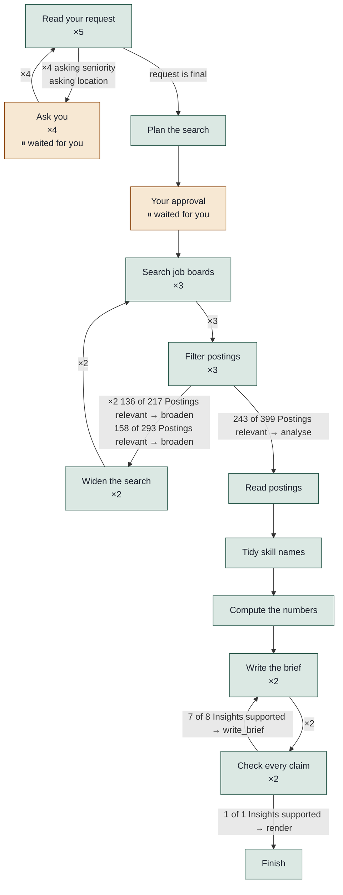

# Routing trace

The path the agent took. Green boxes are Steps it ran, amber boxes are where it stopped and waited for you, and a label on an arrow is the decision it made there. `×2` means that move happened twice.

Not needed in this Run: Too few postings?.
